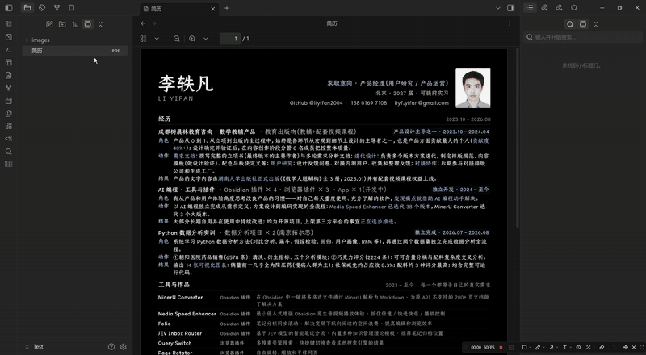

# MinerU Converter

**English** | [简体中文](README.zh.md)

<b>Let MinerU's accurate-parse API and Obsidian work together: convert any PDF / Word / PPT / Excel / image in your vault to editable Markdown with one right-click.</b>

## Quick start

1. Apply for a MinerU API token at <https://mineru.net/apiManage/apiManage> (free tier available).
2. In Obsidian → **Settings → Community plugins → MinerU Converter**, paste the token. Click **Test connection**.
3. Right-click any PDF / Word / PPT / Excel / image → **Convert to Markdown via MinerU**.
4. A `.md` file appears next to the original.

PDFs longer than 200 pages are split and merged automatically — the output looks identical to a non-split conversion.

## Demo

## Documentation

- [User guide](docs/user-guide.md) — quick start, settings, oversized PDFs, the Python batch tool, plugin development
- [Engineering notes](docs/user-guide.md#engineering-notes) — MinerU v4 API reference, rate limits, edge cases
- [Changelog](https://github.com/liyifan2004/obsidian-mineru-converter/releases)
- [Issue tracker](https://github.com/liyifan2004/obsidian-mineru-converter/issues)

## Repository layout

| Path | What's in it |
|---|---|
| [`plugin/`](plugin/) | The Obsidian plugin (TypeScript → bundled `main.js`). Ready to install. |
| [`code/`](code/) | Python tools that pre-date the plugin (252-file batch converter). |
| [`docs/`](docs/) | API notes, engineering write-ups, and the product plan. |

## License

[MIT](LICENSE)
