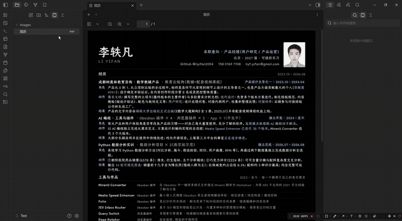

# MinerU Converter

[English](README.md) | **简体中文**

<b>让 MinerU 的精准解析 API 与 Obsidian 协同工作：右键一下，把库里的任意 PDF / Word / PPT / Excel / 图片转换成可编辑的 Markdown。</b>

## 快速上手

1. 在 <https://mineru.net/apiManage/apiManage> 申请 MinerU API token（有免费额度）。
2. 在 Obsidian → **设置 → 第三方插件 → MinerU Converter** 中粘贴 token，点 **Test connection** 验证。
3. 在文件列表中右键任意 PDF / Word / PPT / Excel / 图片 → **Convert to Markdown via MinerU**。
4. 转换出的 `.md` 文件会出现在原文件旁边。

超过 200 页的 PDF 会自动拆分并合并，产出与非拆分转换完全一致。

## 演示

## 文档

- [使用指南](docs/user-guide.zh.md) —— 快速上手、设置页、超长 PDF、Python 批量工具、插件开发
- [工程笔记](docs/user-guide.zh.md#工程笔记) —— MinerU v4 API 参考、速率限制、边界情况
- [更新日志](https://github.com/liyifan2004/obsidian-mineru-converter/releases)
- [问题反馈](https://github.com/liyifan2004/obsidian-mineru-converter/issues)

## 仓库结构

| 路径 | 内容 |
|---|---|
| [`plugin/`](plugin/) | Obsidian 插件本体（TypeScript → 打包为 `main.js`），开箱即用。 |
| [`code/`](code/) | 先于插件存在的 Python 工具（252 文件批量转换器）。 |
| [`docs/`](docs/) | API 笔记、工程实录与产品规划。 |

## License

[MIT](LICENSE)
