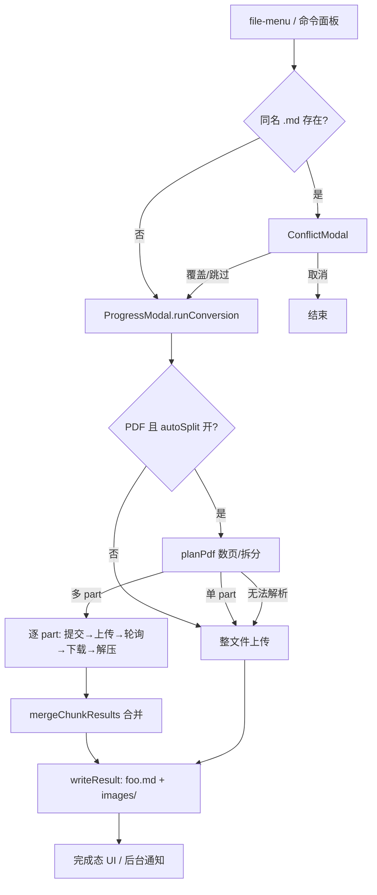

# 功能账簿（Feature Ledger）

MinerU Converter 插件的长期维护依据。记录源码**实际提供**的行为，不是产品宣传，也不是计划书。

- 维护规则：每次改代码后必须同步本文件；功能 ID 保持稳定；只有实际执行过的验证才能标记为"已验证"。
- 事实来源：`plugin/src/**`、`plugin/manifest.json`、构建与 lint 结果。文档（README、03-规划）只作参考，与源码冲突时以源码为准。
- 核对日期：2026-10-23（基于 v0.3.3 / commit 95a13fa）。同日完成首批修复（F-007、F-008、F-010、F-011、F-017、F-018 等），改动见 `CHANGELOG_DEV.md`，**尚未提交**。

## 状态定义

| 状态 | 含义 |
| --- | --- |
| 已实现 | 源码中有完整实现，行为有证据 |
| 已验证 | 已通过自动化脚本或可复现的手动验证 |
| 部分实现 | 只覆盖部分场景，存在明确缺口 |
| 待核实 | 证据不足，未确认 |
| 待实现 | 有明确需求，源码中没有实现 |

## 总览

| ID | 功能 | 状态 | 风险 |
| --- | --- | --- | --- |
| F-001 | 右键菜单转换入口 | 已实现 | 低 |
| F-002 | 命令面板转换入口 | 已实现 | 低 |
| F-003 | 文件类型支持判定 | 已实现 | 低 |
| F-004 | 同名 .md 冲突处理 | 已实现 | 低 |
| F-005 | 单文件转换流水线 | 已实现 | 中 |
| F-006 | 进度展示（相位/分片/进度条） | 已实现 | 低 |
| F-007 | 完成/失败/取消后的操作按钮 | 已实现（本轮修复回归） | 低 |
| F-008 | 后台运行与完成通知 | 已实现（本轮改通知按钮） | 低 |
| F-009 | 超 200 页 PDF 自动拆分与合并 | 已实现 + 已验证 | 中 |
| F-010 | HTML 文件与模型匹配 | 已实现（本轮自动切模型） | 低 |
| F-011 | 文件大小预检（200 MB） | 已实现（本轮） | 低 |
| F-012 | API Token 设置与连通性测试 | 已实现 | 中 |
| F-013 | 解析参数设置 | 已实现 | 低 |
| F-014 | 界面多语言（en / zh-cn） | 已实现 | 低 |
| F-015 | 图片提取与 images/ 写入 | 已实现 | 中 |
| F-016 | API 错误本地化 | 已实现 | 低 |
| F-017 | HTTP 429 自动重试 | 已实现（本轮有界化） | 低 |
| F-018 | 取消（AbortSignal 贯穿） | 已实现（本轮修监听器堆积） | 低 |
| F-019 | 构建 / lint / 发版合规 | 已实现 | 低 |
| F-020 | 构建产物自动同步到本机 vault | 已实现 | 低 |
| F-021 | 控制台日志 | 已实现 | 低 |
| F-022 | 设置持久化 | 已实现 | 低 |

---

## 模块分层与调用关系

```
ui/commands  →  conversion/  →  api/  →  (HTTPS: MinerU v4)
     │               │            │
     │               ├─ utils/pdfSplitter (pdf-lib)
     │               └─ conversion/mergeResults
     ├─ ui/ProgressModal（写盘：md + images/）
     ├─ ui/ConflictModal
     └─ i18n/helpers + utils/logger + utils/constants（全局共享）
```

约定：`api/MinerUClient` 只做 HTTP（提交/上传/轮询/下载/解压）；`utils/pdfSplitter` 只做 PDF 数页与拆页；
`conversion/` 负责编排；`ui/`、`commands/` 只做交互与接线。`conversion/` 与 `utils/pdfSplitter` 不依赖 obsidian，
可在 Node 中离线验证。



---

## 功能明细

### F-001 右键菜单转换入口

- 用户价值：在文件管理器里对单个文件直接发起转换，不离开当前上下文。
- 用户入口：文件资源管理器 / 标签页右键 → "Convert to Markdown via MinerU"（中文界面："使用 MinerU 转换为 Markdown"）。
- 预期行为：仅对受支持扩展名显示菜单项；点击后走 F-004 → F-005 流程。
- 实现位置：`plugin/src/commands/convertFile.ts` `registerConvertFileCommand()`（`workspace.on('file-menu')`）。
- 依赖与约束：Obsidian `file-menu` 事件（签名 `(menu, file, source, leaf?)`，本插件只用前两个参数，已对照 `obsidian@1.13.1` 类型定义核实）。
- 状态：已实现。
- 验证方式：`npm run lint`、`npm run build` 通过；菜单行为未在真实 Obsidian 中回归（本机未跑 UI）。
- 已知问题：无。
- 关联：F-003、F-004、F-005。

### F-002 命令面板转换入口

- 用户价值：键盘流用户可从命令面板发起转换。
- 用户入口：命令面板 → "Convert to Markdown via MinerU"（ID `mineru-convert-file`，稳定不改）。
- 预期行为：无可用文件时命令置灰（`checkCallback`）；目标文件取 active file，其次取最近使用的 leaf 上的文件。
- 实现位置：`convertFile.ts` `registerConvertFileCommand()` + `findActiveSupportedFile()`。
- 状态：已实现。
- 已知问题：焦点在非文件视图时可能取不到文件而置灰，属预期；对"当前选中的非激活文件"无支持（未列入需求）。
- 关联：F-001、F-003。

### F-003 文件类型支持判定

- 用户价值：明确哪些文件可转换，避免误操作。
- 用户入口：菜单项只对受支持文件出现。
- 预期行为：扩展名大小写不敏感；支持 pdf、doc/docx、ppt/pptx、xls/xlsx、png/jpg/jpeg/jp2/webp/gif/bmp、html/htm。
- 实现位置：`utils/constants.ts` `SUPPORTED_EXTENSIONS`；`convertFile.ts` `isSupportedFile()`。
- 依赖与约束：与 MinerU v4 文档声明的支持类型一致（`docs/01-API文档理解.md` 第 26 行）。
- 状态：已实现。
- 已知问题：`html/htm` 列入了支持，但与 F-010 的模型约束冲突，当前会走进必然失败的路径。
- 关联：F-010。

### F-004 同名 .md 冲突处理

- 用户价值：转换结果不会静默覆盖已有笔记。
- 用户入口：目标路径已存在 `.md` 时弹出模态框（覆盖 / 跳过 / 取消）。
- 预期行为：取消或跳过则不产生任何写入；覆盖则继续并在结束时改写目标文件。
- 实现位置：`ui/ConflictModal.ts`；调用点 `convertFile.ts` `runConvert()`。
- 状态：已实现。
- 验证方式：代码走查；未做 UI 回归。
- 已知问题：只检查 `.md`，不检查 `images/` 目录里同名图片（图片名是内容哈希，冲突概率极低，见 F-015）。
  点按钮后 resolver 被调用两次的幂等问题已于 2026-10-23 修复（`settle()` 保证只 resolve 一次）。
- 关联：F-015。

### F-005 单文件转换流水线

- 用户价值：一次点击完成"提交 → 上传 → 解析 → 下载 → 解压"，产出 Markdown 与图片。
- 用户入口：F-001 / F-002 触发后自动执行。
- 预期行为：相位顺序 submitting → uploading → parsing（每 15 s 轮询）→ downloading → extracting → saving；
  失败抛 `MinerUError`，取消抛 `AbortError`；结果含 `mdContent` 与 `images` Map。
- 实现位置：`api/MinerUClient.ts` `convertBytes()`（`convertSingleFile()` 是读盘包装）；解压在 `utils/zipExtractor.ts`。
- 依赖与约束：MinerU v4 `POST /api/v4/file-urls/batch`、`GET /api/v4/extract-results/batch/{id}`、OSS 预签名 PUT、结果 ZIP（`full.md` + `images/`）；Obsidian `requestUrl`。
- 状态：已实现。
- 已知问题：①上传与下载不真正响应 AbortSignal（只在步骤之间检查），大文件取消有延迟；②轮询上限 2 h 写死在 `pollBatch`，与常量 `MAX_POLL_TIME_MS` 重复（见优化清单）；③`extract_progress`（服务端页级进度）已返回但未使用。
- 关联：F-009、F-016、F-017、F-018。

### F-006 进度展示

- 用户价值：长时间任务可见、可预期。
- 用户入口：进度模态框（状态行 + 详情行 + 进度条 + 提示行）。
- 预期行为：拆分场景显示 part x/y 与总进度（跨分片累计，不归零）；不确定相位显示流动进度条。
- 实现位置：`ui/ProgressModal.ts` `renderProgress()`、`setProgress()`；样式 `plugin/styles.css`。
- 状态：已实现。
- 已知问题：无。
- 关联：F-007、F-009。

### F-007 完成 / 失败 / 取消后的操作按钮

- 用户价值：转换结束后能直接打开结果、或关闭窗口；失败后能看清错误并关闭。
- 用户入口：进度模态框底部按钮行。
- 预期行为：成功显示 [打开 Markdown]（主操作，点击后自动关窗）与 [关闭]；失败/取消显示 [关闭]。
- 实现位置：`ProgressModal.ts` `handleDone()` / `handleFailed()` / `handleCancelled()`。
- 状态：**已实现（2026-10-23 修复回归）**。
- 缺陷回顾：v0.3 提交 96b44d7 把 `style.display` 切换重构成 `.mineru-hidden` 类时方向写反，
  导致终态下四个按钮全部隐藏，用户只能点右上角 X。修复即把 `addClass` 恢复为 `removeClass`，并补上成功态的 [关闭]。
- 验证方式：`npm run lint` / `npm run build` 通过；**UI 未在真实 Obsidian 中点过（待核实）**。
- 关联：F-006、F-008。

### F-008 后台运行与完成通知

- 用户价值：长任务不阻塞编辑；完成后告知结果，由用户决定是否打开产物。
- 用户入口：进度模态框 [后台运行]。
- 预期行为：后台完成后弹**常驻通知**，内含 [打开 Markdown] 按钮；点击才打开文件并关闭通知。失败通知为常驻文本。
- 实现位置：`ProgressModal.ts` `handleBackground()`、`notifyBackgroundComplete()`。
- 状态：**已实现（2026-10-23 重做）**。原实现直接 `leaf.openFile()` 抢焦点自动打开，且无操作按钮。
- 技术要点：Notice 无内置操作 API，按钮建在 `createFragment()` 里随消息塞入（兼容 minAppVersion 1.5.0，见 `TECHNICAL_REFERENCES.md` R-02）。
- 验证方式：构建/lint 通过；**通知按钮交互待真机核实**。
- 关联：F-007。

### F-009 超 200 页 PDF 自动拆分与合并

- 用户价值：超过 MinerU 200 页硬限制的 PDF 不再是死路，产出与未拆分转换"看不出区别"。
- 用户入口：设置项 "Auto-split oversized PDFs"（默认开）；转换时自动生效。
- 预期行为：≤200 页整文件原样上传（**字节不变**）；>200 页按 200 页/份拆分，逐份解析（顺序执行，避开 50 文件/分钟限速），正文按页序拼接（**不插分片分隔符**），图片进同一个 `images/`，同名同内容去重、同名异内容改写引用为 `part<n>-` 前缀。任一分片失败 → 整体失败，不落盘。
- 实现位置：`utils/pdfSplitter.ts`（`planPdf`）、`conversion/DocumentConverter.ts`、`conversion/mergeResults.ts`。
- 依赖与约束：`pdf-lib@1.17.1`（纯 JS，可在 Electron 渲染进程运行）；不支持加密 PDF（`pdf-lib` 不能解密，故意不开 `ignoreEncryption`）。
- 状态：已实现 + 已验证。
- 验证方式：离线脚本 `plugin/test/verify-split.ts`（18 项断言，含逐页比对解码内容流字节、边界 200/201 页、图片去重与改名、垃圾输入报错），`npm test` 一键运行（2026-10-23 全通过）。
- 已知问题：①`copyPages` 对扫描件/AcroForm/Tagged PDF 未实测（文档级结构会被丢弃，对 OCR 解析无影响）；②加密 PDF 走整文件回退路径，最终由服务端拒绝。
- 关联：F-005、F-016。

### F-010 HTML 文件与模型匹配

- 用户价值：HTML 文件能被正确解析，不需要用户懂模型约束。
- 用户入口：与 F-001 相同（html/htm 在支持列表里）。
- 预期行为：HTML 输入必须使用 `MinerU-HTML` 模型（`docs/01-API文档理解.md` 第 107、519 行）。现在插件按扩展名自动切换模型（`resolveModelVersion()`），并在转换开始时弹提示说明"本次转换忽略你的模型设置"；非 HTML 文件完全不受影响。
- 实现位置：`utils/constants.ts` `resolveModelVersion()`；调用点 `ProgressModal.ts` `runConversion()`。
- 状态：**已实现（2026-10-23）**。
- 验证方式：`npm run lint` / `npm run build` 通过；模型切换的实际效果**未用真实 HTML 文件验证（待核实）**。
- 关联：F-003、F-013。

### F-011 文件大小预检（200 MB）

- 用户价值：超限文件在上传前就得到明确提示，不浪费上传与等待。
- 预期行为：转换前比较 `file.stat.size` 与 `MAX_FILE_SIZE`，超限直接弹本地化提示（含实际 MB 数）并终止；顺带补了"文件已被删除/移动"的存在性检查。
- 实现位置：`commands/convertFile.ts` `runConvert()`；常量 `utils/constants.ts`；文案 `fileTooLarge` / `fileNotFound`。
- 状态：**已实现（2026-10-23）**。
- 验证方式：`npm run lint` / `npm run build` 通过；未造 200 MB+ 文件实测（待核实，风险低）。
- 关联：F-016。

### F-012 API Token 设置与连通性测试

- 用户价值：录入凭据并快速确认有效。
- 用户入口：设置页 Token 输入框（password 型）+ [Test connection]。
- 预期行为：Token 存 `data.json`（仅本机）；用零值 UUID 探测 `GET /extract-results/batch/{id}`：200 = 有效；
  401/403 = 无效/过期（按响应里的 `msgCode` 给出 A0202/A0211 本地化提示）；其他 4xx = 鉴权已通过，只是探测 ID 不存在，视为有效。
- 实现位置：`settings.ts` `addTokenControls()`；`api/MinerUClient.ts` `testConnection()`。
- 状态：**已实现 + 已修复（2026-10-23）**。
- 缺陷回顾：旧判定读 `body.code`，但鉴权失败的实际响应体是 `{ success, msgCode, msg, traceId, total }`（字段叫 `msgCode`），
  于是判断永不命中，**无效 token 也会报 "Token looks valid"**。已按实测响应重写判定（见 `TECHNICAL_REFERENCES.md` R-06）。
- 验证方式：无效 token 实测 HTTP 401 + `msgCode: A0211`（2026-10-23）；**有效 token 路径未实测**（需用户点一次 [测试连接]）。
- 关联：F-016。

### F-013 解析参数设置

- 用户价值：按文档语言、公式/表格需求、模型版本调整解析行为。
- 用户入口：设置页 6 项（Token、模型、语言、公式、表格、自动拆分）。
- 预期行为：改完即存；模型三选一 `pipeline / vlm / MinerU-HTML`，语言七选一。
- 实现位置：`settings.ts`（`getSettingDefinitions` 声明式 + `display()` 命令式双轨）。
- 依赖与约束：声明式设置 API 是 Obsidian 1.13+ 的 `PluginSettingTab.getSettingDefinitions()`，已对照 `obsidian@1.13.1` 类型定义核实存在，且 `display()` 在返回非空 definitions 时不再被调用——双轨共存安全；minAppVersion 仍是 1.5.0，所以 `display()` 不能删。
- 状态：已实现。
- 已知问题：两处渲染代码（声明式 + 命令式）必须同步改，改设置项时容易漏一处（靠评审把关）。
- 关联：F-010。

### F-014 界面多语言

- 用户价值：中英文界面自动跟随 Obsidian 语言。
- 实现位置：`i18n/helpers.ts`（`moment.locale()` 解析 + 回退链）、`i18n/locale/en.ts`（85 个 key，类型基准）、`zh-cn.ts`（85 个 key）。
- 状态：已实现。验证：脚本比对 en/zh-cn 键集合，81/81 完全一致（2026-10-23，修复后复核）。
- 已知问题：本轮删除了 6 个无调用点 key（`pluginName`、`pluginDesc`、`cmdConvertFileTooltip`、`unsupportedFileType`、`settingsTestFail`、`bgDoneOpenedNotice`），
  新增 `conflictSkipped`、`htmlModelForced`，`fileTooLarge` / `fileNotFound` / `apiErrRateLimit` 均已接线。当前**全部 81 个 key 均有调用点**。
- 关联：全部 UI 功能。

### F-015 图片提取与 images/ 写入

- 用户价值：转换产物里的图片可用，Markdown 引用可解析。
- 预期行为：ZIP 内 `images/**` 按相对路径写到 `.md` 同目录 `images/` 下；嵌套子目录自动创建；Markdown 引用原样成立。
- 实现位置：`utils/zipExtractor.ts` `extractFromZip()` / `safeImageKey()`；`ProgressModal.ts` `writeResult()`。
- 状态：已实现（2026-11-03 补路径穿越防护，见 O-001）。
- 已知问题：①图片文件写入用 `adapter.writeBinary`，同名直接覆盖、无提示（图片名是内容哈希，覆盖即同内容，风险非零但极低）；②ZIP 解压按 `full.md` / `images/` 过滤，其余文件（layout.json 等）丢弃——符合需求。
  2026-10-23 起写入顺序改为**先图片、后 .md**（.md 是提交标记，避免半成品 .md 引用缺失图片）。
- 关联：F-004、F-009、O-001。

### F-016 API 错误本地化

- 用户价值：报错说人话、说下一步动作。
- 实现位置：`api/MinerUClient.ts` `localizeApiError()`（A0202/A0211/60005-60018 映射）+ `PAGE_LIMIT_PATTERNS`（把服务端自由文本"页数超限"归一为 `page-limit`）；文案在 i18n。
- 状态：已实现（2026-10-23 补双响应壳归一：`code` 与 `msgCode` 都能进映射，见 R-06）。
- 已知问题：`DocumentConverter` 对分片失败抛 `new Error(t('partFailed')…)`（非 `MinerUError`），UI 层按普通 Error 处理——行为正确但类型不统一，未来加错误分类时易漏。
- 关联：F-005、F-009、F-011、F-012。

### F-017 HTTP 429 自动重试

- 用户价值：触发限速时不直接失败。
- 实现位置：`MinerUClient.requestWithRetry()`（429 → 等 65 s 重试，最多 `HTTP_429_MAX_RETRIES` = 5 次，超限抛 `rate-limit`，本地化为"请稍等几分钟再试"）。
- 状态：已实现（2026-10-23 由无限重试改为有界重试）。
- 已知问题：无。
- 关联：F-005、F-018。

### F-018 取消（AbortSignal 贯穿）

- 用户价值：随时终止任务，不留后台流量。
- 实现位置：`ProgressModal` 持有 `AbortController`，贯穿 `DocumentConverter` / `MinerUClient` / `pdfSplitter`。
- 状态：已实现。
- 已知问题：`sleep()` 的 abort 监听器堆积问题、写盘阶段取消仍会写盘的问题均已于 2026-10-23 修复（监听器结束时移除；`writeResult` 入口检查 abort）。若在多图写入中途取消，已写图片会留下（内容哈希命名，无害），.md 不会写出。
- 关联：F-005、F-017。

### F-019 构建 / lint / 发版合规

- 用户价值：可复现构建 + 通过 Obsidian 社区审查 + 产物可验证来源。
- 实现位置：`plugin/esbuild.config.mjs`（tsc 类型检查 + 打包，构建时把 manifest/versions 同步到仓库根）、`plugin/eslint.config.js`（eslint-plugin-obsidianmd recommended）、`.github/workflows/release.yml`（lint → build → tag 与 manifest 版本一致 → attestation 签名 → 只发 3 个文件）。
- 状态：已实现。验证：2026-10-23 `npm run lint`（0 问题）、`npm run build` 通过。
- 约束：公开 release 资产必须由 CI 构建上传（手传会断 provenance 链）；解压用 fflate 不用 jszip（jszip → setimmediate 触发审查拒绝，见 `utils/zipExtractor.ts` 注释）。
- 关联：全部。

### F-020 构建产物自动同步到本机 vault

- 用户价值：改完即在真实 Obsidian 里生效。
- 实现位置：`plugin/scripts/sync.mjs`（目标 `D:\MyNotes\学-习\.obsidian\plugins\obsidian-mineru`）、`plugin/hooks/post-commit`（`core.hooksPath=plugin/hooks`，仅当 commit 触及 plugin/ 时同步）。
- 状态：已实现。
- 已知问题：目标 vault 里用户的 `data.json`（token）绝不能被覆盖——当前 sync 只拷 3 个文件，安全。
- 关联：F-019。

### F-021 控制台日志

- 实现位置：`utils/logger.ts`（仅 `console.debug/warn/error`，符合审查规则）；调用点 convertFile / MinerUClient / DocumentConverter。
- 状态：已实现。已知问题：`convertFile.ts` 的 log 实例只有 1 处 debug 调用，可留可删。

### F-022 设置持久化

- 实现位置：`main.ts` `loadSettings/saveSettings`（`Object.assign` 合并默认值）。
- 状态：已实现。
- 已知问题：新增设置项时旧 `data.json` 会自动补默认值，无迁移问题；无版本号字段，未来若改语义需自行迁移。

---

## 死代码清理记录（2026-10-23）

本轮核对发现并处理的无调用点代码（如需回查用 `git show 95a13fa`）：

| 项目 | 原位置 | 处理 |
| --- | --- | --- |
| `PLUGIN_ID = 'obsidian-mineru'` | `utils/constants.ts` | 删除。值与 `manifest.json` 的 `mineru-converter` 不一致，注释描述的"故意落后"已被 0.3.1 的改名推翻，且全库无引用 |
| `PLUGIN_VIEW_TYPE` | `main.ts` | 删除（预留视图类型占位，无注册） |
| `progress()` | `api/MinerUClient.ts` | 删除（无调用点） |
| `DEFAULT_BATCH_SIZE` / `DEFAULT_BATCH_DELAY_SEC` | `utils/constants.ts` | 删除（是 Python 批量脚本的参数，插件单文件流程用不到） |
| i18n 6 个 key | `en.ts` / `zh-cn.ts` | 删除（见 F-014） |
| `HTML_EXTENSIONS` / `MAX_FILE_SIZE` / `DEFAULT_POLL_INTERVAL_SEC` / `MAX_POLL_TIME_MS` | `utils/constants.ts` | **保留并接线**（分别用于 F-010 / F-011 / F-005 轮询） |

## 审查与优化清单

优先级：P0 数据丢失/崩溃/核心不可用；P1 核心缺陷或高频障碍；P2 明确收益的改进；P3 低风险优化与探索。

| ID | 优先级 | 问题 | 证据 | 方案 | 状态 |
| --- | --- | --- | --- | --- | --- |
| O-001 | P0 | **ZIP 路径穿越**：结果 ZIP 来自远端服务器，条目名是不可信输入。`fflate` 不做净化，原样返回 `result/images/../../../../evil.txt`；Obsidian `normalizePath()` 只折叠斜杠、**不解析 `..`**；`adapter.writeBinary()` 会照写。可写出 `images/` 目录之外的文件 | 实测：构造恶意 ZIP → `extractFromZip()` 返回的 key 含 `../../../../evil.txt`、`../sibling.png`（已复现）；`obsidian.d.ts:4606` `normalizePath` 签名无 `..` 处理说明 | 新增 `safeImageKey()`：拒绝含 `..` 段、绝对路径、盘符、反斜杠、空/`.` 段的条目；解压端与写入端**双重校验**（写入端为纵深防御，不信任调用方） | ✅ 2026-11-03 完成（新增 `verify-zip.ts` 12 项断言，全通过） |

## 测试覆盖现状

| 范围 | 手段 | 状态 |
| --- | --- | --- |
| PDF 拆分/合并（F-009） | `plugin/test/verify-split.ts`（18 项断言，含逐页比对解码内容流字节、边界 200/201 页、图片去重改名） | **已验证**：`npm test` 2026-10-23 全通过 |
| ZIP 解压（F-015） | `plugin/test/verify-zip.ts`（7 项断言） | **已验证**：同上 |
| ZIP 路径穿越防护（O-001） | `plugin/test/verify-zip.ts`（+12 项断言：恶意 ZIP 条目被丢弃、`safeImageKey` 各类输入） | **已验证**：2026-11-03 全通过 |
| 测试入口 | `plugin/test/run.mjs`（esbuild 打包后跑 node）+ `npm test` | 已实现；测试文件不进 `npm run build` 的 tsc 检查范围 |
| 类型 / lint | `tsc -noEmit` + eslint-obsidianmd | 每次构建自动执行，当前 0 错 0 警 |
| UI 流程（F-001/004/006/007/008） | 无 | **未验证**（需真实 Obsidian） |
| 网络流水线（F-005/012/017） | 无（无 mock） | **未验证** |
