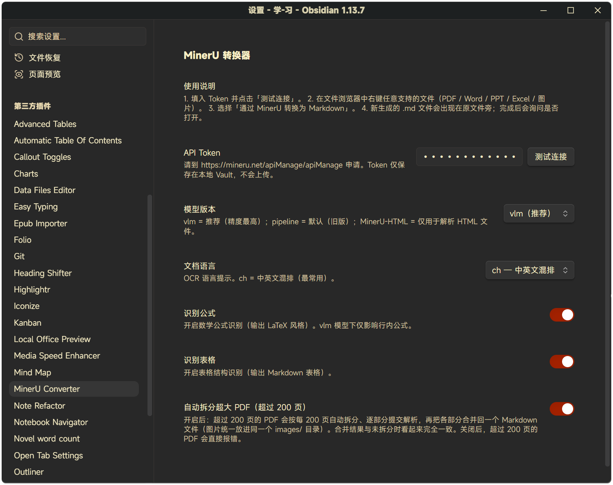

# MinerU Converter User Guide

> This is the complete documentation. The README only carries the intro and the quick start — details live here.

## Quick start (Obsidian plugin)

1. Apply for a MinerU API token at <https://mineru.net/apiManage/apiManage> (free tier available).
2. In Obsidian → **Settings → Community plugins → MinerU Converter**, paste the token. Click **Test connection** to verify.
3. Right-click any PDF / Word / PPT / Excel / image in the file explorer → **Convert to Markdown via MinerU**.
4. A `.md` file appears next to the original. The plugin will ask if you want to open it.

### Oversized PDFs

**PDFs longer than 200 pages** are handled automatically: the plugin splits the page tree into 200-page parts, submits each part to MinerU in turn, then merges the Markdown and images back into a single `.md` file next to the original. The output looks identical to a non-split conversion — no part markers, one shared `images/` folder. Turn this off in **Settings → MinerU Converter → Auto-split oversized PDFs**.

For supported formats and limits, see [`docs/03-Obsidian插件开发规划.md`](03-Obsidian插件开发规划.md).

## Settings

**Settings** — API token, model version, OCR language, formula / table recognition, auto-split for oversized PDFs:



## Quick start (Python batch tool)

If you have hundreds of files to convert, the plugin's per-file flow is slow. Use the Python tools in [`code/`](../code/) instead:

```bash
pip install requests PyPDF2
# Edit TOKEN and ROOT_DIR at the top of code/mineru_convert.py
python code/mineru_convert.py
```

The script auto-batches (40 files per batch, 70 s between batches to respect MinerU's 50/min limit), resumes on re-run, and writes `.md` siblings in place.

## Plugin development

```bash
cd plugin
npm install
npm run dev   # watch mode, auto-rebuilds main.js
```

To test locally, copy the produced `main.js`, `manifest.json`, and `styles.css` into `<your-vault>/.obsidian/plugins/mineru-converter/`, then enable **Community plugins → MinerU Converter** in Obsidian settings.

Releases are built and attested by GitHub Actions when a bare-semver tag is pushed. Every asset carries a GitHub artifact attestation and can be verified with `gh attestation verify main.js -R liyifan2004/obsidian-mineru-converter`. See [`plugin/README.md`](../plugin/README.md#release) for the release flow.

## Engineering notes

These are the hard-won details behind the plugin — read them before extending it.

- [`docs/01-API文档理解.md`](01-API文档理解.md) — structured understanding of the MinerU v4 API: every endpoint, parameter, state machine, and error code.
- [`docs/02-实操经验总结.md`](02-实操经验总结.md) — rate limits, CDN SSL workaround, 200-page limit, encrypted PDFs, proxy pitfalls, batch processing.
- [`docs/03-Obsidian插件开发规划.md`](03-Obsidian插件开发规划.md) — product plan, technical design, and interaction patterns for the plugin.
