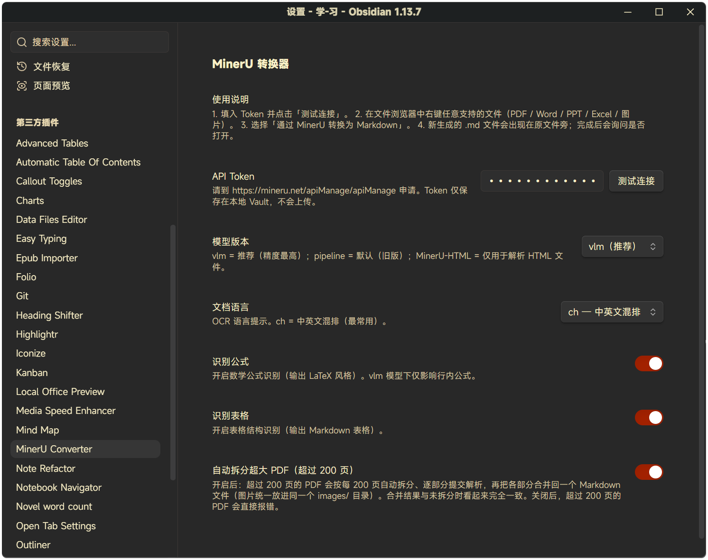

# MinerU Converter 使用指南

> 本文是插件的完整说明。README 只放简介与快速上手，具体细节看这里。

## 快速上手（Obsidian 插件）

1. 在 <https://mineru.net/apiManage/apiManage> 申请 MinerU API token（有免费额度）。
2. 在 Obsidian → **设置 → 第三方插件 → MinerU Converter** 中粘贴 token，点 **Test connection** 验证。
3. 在文件列表中右键任意 PDF / Word / PPT / Excel / 图片 → **Convert to Markdown via MinerU**。
4. 转换出的 `.md` 文件会出现在原文件旁边，插件会询问是否打开。

### 超长 PDF

**超过 200 页的 PDF** 会自动处理：插件把页面树拆成 200 页一份，逐份提交给 MinerU，再把 Markdown 和图片合并回原文件旁的一个 `.md`。产出与非拆分转换完全一致——没有分段标记，共用一个 `images/` 目录。可在 **Settings → MinerU Converter → Auto-split oversized PDFs** 中关闭。

支持格式与限制见 [`docs/03-Obsidian插件开发规划.md`](03-Obsidian插件开发规划.md)。

## 设置页

**设置页**——API token、模型版本、OCR 语言、公式/表格识别、超长 PDF 自动拆分：



## 快速上手（Python 批量工具）

如果有成百上千个文件要转，插件的逐文件流程太慢。改用 [`code/`](../code/) 里的 Python 工具：

```bash
pip install requests PyPDF2
# 编辑 code/mineru_convert.py 顶部的 TOKEN 和 ROOT_DIR
python code/mineru_convert.py
```

脚本自动分批（每批 40 个文件，批间隔 70 秒以遵守 MinerU 的 50 次/分钟限制），支持断点续传，`.md` 原地生成。

## 插件开发

```bash
cd plugin
npm install
npm run dev   # watch 模式，自动重新构建 main.js
```

本地测试：把产出的 `main.js`、`manifest.json`、`styles.css` 复制到 `<your-vault>/.obsidian/plugins/mineru-converter/`，然后在 Obsidian 设置中启用 **Community plugins → MinerU Converter**。

发版：推送纯 semver 格式 tag（如 `0.3.3`）后，GitHub Actions 自动构建并签名发布 Release。所有资产都带 GitHub artifact attestation，可用 `gh attestation verify main.js -R liyifan2004/obsidian-mineru-converter` 验证来源。完整流程见 [`plugin/README.md`](../plugin/README.md#release)。

## 工程笔记

插件背后的实操细节——要扩展它之前先读这些。

- [`docs/01-API文档理解.md`](01-API文档理解.md) —— MinerU v4 API 的结构化理解：每个端点、参数、状态机与错误码。
- [`docs/02-实操经验总结.md`](02-实操经验总结.md) —— 踩坑实录：速率限制、CDN SSL 问题、200 页上限、加密 PDF、代理陷阱、批量处理。
- [`docs/03-Obsidian插件开发规划.md`](03-Obsidian插件开发规划.md) —— 本插件的产品规划、技术设计与交互设计。
